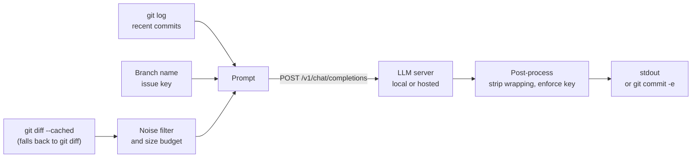

<h1 align="center">gitmsg</h1>

<p align="center">
  <strong>Commit messages that sound like your repository, written by the LLM of your choice.</strong>
</p>

<p align="center">
  A single-file CLI that drafts git commit messages with any OpenAI-compatible API —
  a local model on your own machine or a hosted, paid one.
</p>

<p align="center">
  
  
  
  
  <a href="LICENSE"></a>
</p>

gitmsg reads your staged diff, learns the commit style from the repository's own
history, and asks a model for a draft. Point it at whatever you already run: a local
server such as Ollama or LM Studio, or a hosted API such as OpenAI or OpenRouter.

It is built for people who hop between many repositories with different
conventions. There is no per-repository config to copy around — every repository
teaches its own style through its history.

## Features

| Feature | What you get |
|---|---|
| **Bring your own model** | Works with any server that speaks the OpenAI Chat Completions API, local or hosted. Switch with `--url` or `GITMSG_LLM_URL`. |
| **Learns each repository's style** | The 25 most recent subjects and up to 3 commits with a body are sent as few-shot examples, so the draft follows whatever format the repository already uses. |
| **Issue keys from the branch** | A key such as `ABC-102` in `feature/ABC-102` is guaranteed to appear in the subject, placed in the style the history uses (`ABC-1 ...`, `[ABC-1] ...` or `... (ABC-1)`). With no key in the branch, none is invented. |
| **Diff budgeting** | Lock files, minified assets, build output (`dist/`, `build/`, `target/`, `node_modules/`) and binaries are reduced to their filenames. Bodies are capped at 6,000 characters per file and 48,000 in total, shrinking the largest files first. |
| **Clean output** | Code fences, surrounding quotes and `Commit message:` prefixes the model adds are stripped. |
| **Pipe-friendly** | Progress goes to stderr and only the message goes to stdout, so `gitmsg \| pbcopy` (macOS) or `gitmsg \| clip` (Windows) copies just the message. |
| **Edit before committing** | `-e` opens `git commit -e` with the draft filled in. There is no path that commits without your confirmation. |
| **English and Korean** | Output language is English by default; `--lang ko` switches both the CLI text and the commit message to Korean. |
| **Zero dependencies** | One Python file using only the standard library. No virtual environment, no `pip install`. |

## How it works



1. Look at staged changes first. If nothing is staged, use tracked but unstaged changes.
2. Keep only the filename for lock files, build artifacts and binaries.
3. Fit diffs into the budget of 6,000 characters per file and 48,000 overall.
4. Attach the last 25 commit subjects and up to 3 commits with a body as examples.
5. Call `<url>/v1/chat/completions` once.
6. Strip code fences and quotes, and add the issue key if the model left it out.

## Choose a model backend

gitmsg needs two things from a backend: a **base URL** and, if the service requires
one, an **API key**. It appends `/v1/models` and `/v1/chat/completions` to the base URL
and sends the key as an `Authorization: Bearer` header.

| Backend | Kind | Base URL (`GITMSG_LLM_URL`) | API key | Platforms |
|---|---|---|---|---|
| [Ollama](https://ollama.com) | Local | `http://127.0.0.1:11434` | Not needed | macOS, Windows, Linux |
| [LM Studio](https://lmstudio.ai) | Local | `http://127.0.0.1:1234` | Not needed | macOS, Windows, Linux |
| [llama.cpp server](https://github.com/ggml-org/llama.cpp) | Local | `http://127.0.0.1:8080` (default) | Only if you set one | macOS, Windows, Linux |
| [Nativ](https://github.com/Blaizzy/nativ) | Local | `http://127.0.0.1:8080` (default) | Required | macOS (Apple silicon) |
| [OpenAI](https://platform.openai.com) | Hosted, paid | `https://api.openai.com` | Required | Any |
| [OpenRouter](https://openrouter.ai) | Hosted, paid | `https://openrouter.ai/api` | Required | Any |
| [Groq](https://groq.com) | Hosted | `https://api.groq.com/openai` | Required | Any |

gitmsg was developed and measured against Nativ. The other rows follow each
project's documented OpenAI-compatible endpoint. Any other service works the same
way as long as its chat endpoint lives at `<base URL>/v1/chat/completions`.

A few things to keep in mind:

- **Privacy.** With a local backend, your code never leaves your machine. With a
  hosted API, the diff and your recent commit messages are sent to that provider.
  Check that this is allowed for the repository you are working on.
- **Pick the model explicitly on hosted APIs.** Without `--model`, gitmsg uses the
  first model the server lists. That is fine for a local server with one model
  loaded, but a hosted API lists many, so always pass `--model <model-id>`.
- **Use a regular chat model.** gitmsg sends `temperature` and `max_tokens`. Some
  reasoning models reject those parameters and will return an error.
- **Local models must be loaded first.** For example `ollama pull <model>` in Ollama,
  or loading a model and starting the local server in LM Studio.

## Requirements

- Python 3.9 or newer.
  - macOS: the system `python3` is fine.
  - Windows: install it from [python.org](https://www.python.org/downloads/) and tick
    "Add python.exe to PATH".
- git.
- One of the backends above.

gitmsg is developed and tested on macOS. It uses only the cross-platform parts of
the standard library, so it runs on Windows as well. Windows has had less testing,
though, so please [open an issue](https://github.com/lizen/local-ai-commit/issues)
if something breaks there.

## Get started

### Install on macOS

```sh
git clone https://github.com/lizen/local-ai-commit.git
cd local-ai-commit
chmod +x gitmsg.py
ln -sf "$PWD/gitmsg.py" ~/.local/bin/gitmsg   # make sure ~/.local/bin is on your PATH
```

### Install on Windows

```powershell
git clone https://github.com/lizen/local-ai-commit.git
cd local-ai-commit
python gitmsg.py --help
```

To run it as `gitmsg` from any folder, create a file named `gitmsg.cmd` in a folder
that is on your `PATH`, with this single line. Adjust the path to where you cloned
the repository:

```bat
@python "%USERPROFILE%\local-ai-commit\gitmsg.py" %*
```

To customize gitmsg, fork the repository and clone your fork instead.

### Point it at your backend

Set the base URL and, if needed, the API key. For example, Ollama on the default
port needs only the URL, while OpenAI needs both:

macOS (add to `~/.zshrc` to keep it):

```sh
export GITMSG_LLM_URL='http://127.0.0.1:11434'   # Ollama
export GITMSG_LLM_API_KEY='...'                  # only for backends that need a key
```

Windows (PowerShell; `setx` keeps the value for new terminals):

```powershell
setx GITMSG_LLM_URL "https://api.openai.com"
setx GITMSG_LLM_API_KEY "..."
```

Without `GITMSG_LLM_URL`, gitmsg uses `http://127.0.0.1:8080`, the default port of
llama.cpp server and Nativ.

Keep the key in an environment variable rather than passing `--api-key`: a
command-line argument shows up in process listings and your shell history. On
macOS, if you keep it in a shell profile, set that file's permissions to `600`.

### First run

Stage some changes and run:

```sh
gitmsg                              # local backend with one model loaded
gitmsg --model <model-id>           # hosted API
```

```
Project: /Users/me/work/example-backend
Analyzing changes...

Suggested commit message:
ABC-102 Handle missing user in findById
```

## Usage

```sh
gitmsg                                 # draft from the current repository
gitmsg ~/work/team-a/example-backend   # target another repository
gitmsg -e                              # open the commit editor with the draft
gitmsg --print-prompt                  # show the assembled prompt, no model call
gitmsg | pbcopy                        # macOS: copy only the message
gitmsg | clip                          # Windows: copy only the message
```

gitmsg works from any subdirectory: the path (default `.`) is resolved to the
top level of the git repository that contains it.

| Option | Description |
|---|---|
| `PATH` | Target repository path. Defaults to the current directory. |
| `-e`, `--edit` | Open the editor with `git commit -e`. |
| `--model ID` | Model to use. Defaults to the first model the server lists. |
| `--url URL` | Base URL of the OpenAI-compatible API. Defaults to `GITMSG_LLM_URL`, then `http://127.0.0.1:8080`. |
| `--api-key KEY` | API key. Defaults to `GITMSG_LLM_API_KEY`. Not recommended for everyday use. |
| `--lang {en,ko}` | Output language. Defaults to `GITMSG_LANG`, then `en`. |
| `--print-prompt` | Print the assembled prompt and exit. |

### Environment variables

| Variable | Purpose |
|---|---|
| `GITMSG_LLM_URL` | Base URL of the backend. `GITMSG_URL` is still read as a fallback for older setups. |
| `GITMSG_LLM_API_KEY` | API key sent as a Bearer token. `NATIV_API_KEY` is still read as a fallback for older setups. |
| `GITMSG_LANG` | Output language, `en` or `ko`. |

### Output language

| Value | Commit message | CLI notices, errors, help |
|---|---|---|
| `en` (default) | Always English | English |
| `ko` | Always Korean | Korean |

```sh
gitmsg --lang ko          # Korean for this run
export GITMSG_LANG=ko     # Korean every time (Windows: setx GITMSG_LANG ko)
```

The language setting wins over the repository history: a repository with Korean
commits still gets English messages unless you ask for Korean. If you mostly work
in Korean repositories, set `GITMSG_LANG=ko` permanently.

To add a language, add a block to the `MESSAGES` dictionary in `gitmsg.py` and its
code to `SUPPORTED_LANGS`. A test checks that every language has the same keys and
the same `%s`/`%d` placeholders.

### Exit codes

| Code | Meaning |
|---|---|
| `0` | Success |
| `1` | Not a git repository, no changes, or an unsupported `GITMSG_LANG` value |
| `2` | LLM server, authentication or model problem, or an invalid command-line option |

With `-e`, gitmsg returns the exit code of `git commit` itself, so a rejecting
pre-commit hook or closing the editor without saving can also yield `1`.

## Performance

Speed depends almost entirely on your backend. As one data point, measured on
2026-09-15 on an Apple silicon Mac with Nativ 0.3.7 and
`mlx-community/KAT-Coder-V2.5-Dev-OptiQ-4bit`:

| Diff size | Generation time |
|---|---|
| 1 file, 2 lines (subject only) | 5.6 s |
| 1 file, ~15 lines (subject + 3-line body) | 57 s |

Time depends on how many tokens the model **generates**, much more than on prompt
length. On a local model, expect close to a minute when the message needs a body.
Hosted APIs are usually much faster. gitmsg waits up to 180 seconds for a response.

A real draft from that run, on branch `feature/ABC-102` in a repository whose
history uses Korean subjects with an `ABC-100 ...` prefix. It was generated before
English became the default, so today you would get it with `--lang ko`:

```
ABC-102 findById 예외 처리 및 사용자 잠금 기능 추가

- findById: null 반환 대신 UserNotFoundException 던지도록 변경
- lock: 사용자 잠금 설정 메서드 추가
```

The issue key from the branch landed in the same prefix style as the history.

## Development

```sh
python3 -m unittest discover -s tests -v
```

The tests never touch the network or your real repositories. Git integration tests
create throwaway repositories in a temporary directory.

## Documentation

Design notes are written in Korean.

[Design](docs/design.md) | [Decision log](docs/decisions.md) | [Implementation plan](plans/2026-09-14-gitmsg.md)

## License

[MIT License](LICENSE). You are free to use, modify, fork and redistribute gitmsg,
as long as the copyright and license notice are kept.
