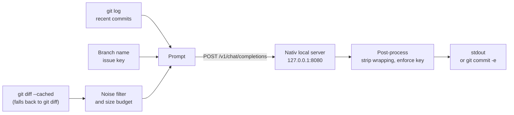

<h1 align="center">gitmsg</h1>

<p align="center">
  <strong>Commit messages that sound like your repository, written by a local LLM.</strong>
</p>

<p align="center">
  A single-file CLI that drafts git commit messages with a model running in
  <a href="https://github.com/Blaizzy/nativ">Nativ</a> on your Mac.
</p>

<p align="center">
  
  
  
  
</p>

gitmsg reads your staged diff, learns the commit style from the repository's own
history, and asks a locally loaded model for a draft. Your code stays on your
machine: by default the only network call goes to the Nativ server on `127.0.0.1`.

It is built for people who hop between many repositories with different
conventions. There is no per-repository config to copy around — every repository
teaches its own style through its history.

## Features

| Feature | What you get |
|---|---|
| **Learns each repository's style** | The 25 most recent subjects and up to 3 commits with a body are sent as few-shot examples, so the draft follows whatever format the repository already uses. |
| **Issue keys from the branch** | A key such as `ABC-102` in `feature/ABC-102` is guaranteed to appear in the subject, placed in the style the history uses (`ABC-1 ...`, `[ABC-1] ...` or `... (ABC-1)`). With no key in the branch, none is invented. |
| **Diff budgeting** | Lock files, minified assets, build output (`dist/`, `build/`, `target/`, `node_modules/`) and binaries are reduced to their filenames. Bodies are capped at 6,000 characters per file and 48,000 in total, shrinking the largest files first. |
| **Clean output** | Code fences, surrounding quotes and `Commit message:` prefixes the model adds are stripped. |
| **Pipe-friendly** | Progress goes to stderr and only the message goes to stdout, so `gitmsg \| pbcopy` copies just the message. |
| **Edit before committing** | `-e` opens `git commit -e` with the draft filled in. There is no path that commits without your confirmation. |
| **English and Korean** | Output language is English by default; `--lang ko` switches both the CLI text and the commit message to Korean. |
| **Zero dependencies** | One Python file using only the standard library. Works with the system `python3` on macOS. |

## How it works



1. Look at staged changes first. If nothing is staged, use tracked but unstaged changes.
2. Keep only the filename for lock files, build artifacts and binaries.
3. Fit diffs into the budget of 6,000 characters per file and 48,000 overall.
4. Attach the last 25 commit subjects and up to 3 commits with a body as examples.
5. Call `/v1/chat/completions` once.
6. Strip code fences and quotes, and add the issue key if the model left it out.

## Requirements

- A Mac with Apple silicon running [Nativ](https://github.com/Blaizzy/nativ), with its
  **local API server turned on** and a model loaded.
  `mlx-community/KAT-Coder-V2.5-Dev-OptiQ-4bit` is recommended.
- The Nativ API key, exported as `NATIV_API_KEY`. The server rejects requests without it.
- Python 3.9 or newer (the macOS system `python3` is fine) and git.

## Get started

### Install

```sh
git clone https://github.com/lizen/local-ai-commit.git ~/PersonalProject/llm-gitmsg
cd ~/PersonalProject/llm-gitmsg
chmod +x gitmsg.py
ln -sf "$PWD/gitmsg.py" ~/.local/bin/gitmsg   # make sure ~/.local/bin is on your PATH
```

No virtual environment is needed.

### Set the API key

Copy the key from the Nativ app and export it:

```sh
export NATIV_API_KEY='...'
```

The key is never stored in this repository. If you keep it in a shell profile, set
that file's permissions to `600`. Prefer the environment variable over `--api-key`:
a command-line argument shows up in `ps` output and your shell history.

### First run

Stage some changes and run:

```sh
gitmsg
```

```
Project: /Users/me/work/example-backend
Analyzing changes...

Suggested commit message:
ABC-102 Handle missing user in findById
```

## Usage

```sh
gitmsg                                 # draft from the current repository
gitmsg ~/work/team-a/example-backend   # target another repository
gitmsg -e                              # open the commit editor with the draft
gitmsg --print-prompt                  # show the assembled prompt, no model call
gitmsg | pbcopy                        # copy only the message
```

gitmsg works from any subdirectory: the path (default `.`) is resolved to the
top level of the git repository that contains it.

| Option | Description |
|---|---|
| `PATH` | Target repository path. Defaults to the current directory. |
| `-e`, `--edit` | Open the editor with `git commit -e`. |
| `--model ID` | Model to use. Defaults to the first loaded model. |
| `--url URL` | Nativ server URL. Also settable via `GITMSG_URL`. Defaults to `http://127.0.0.1:8080`. |
| `--api-key KEY` | Nativ API key. Defaults to `NATIV_API_KEY`. Not recommended for everyday use. |
| `--lang {en,ko}` | Output language. Defaults to `GITMSG_LANG`, then `en`. |
| `--print-prompt` | Print the assembled prompt and exit. |

### Output language

| Value | Commit message | CLI notices, errors, help |
|---|---|---|
| `en` (default) | Always English | English |
| `ko` | Always Korean | Korean |

```sh
gitmsg --lang ko          # Korean for this run
export GITMSG_LANG=ko     # Korean every time
```

The language setting wins over the repository history: a repository with Korean
commits still gets English messages unless you ask for Korean. If you mostly work
in Korean repositories, put `GITMSG_LANG=ko` in your shell profile.

To add a language, add a block to the `MESSAGES` dictionary in `gitmsg.py` and its
code to `SUPPORTED_LANGS`. A test checks that every language has the same keys and
the same `%s`/`%d` placeholders.

### Exit codes

| Code | Meaning |
|---|---|
| `0` | Success |
| `1` | Not a git repository, no changes, or an unsupported `GITMSG_LANG` value |
| `2` | Nativ server, authentication or model problem, or an invalid command-line option |

With `-e`, gitmsg returns the exit code of `git commit` itself, so a rejecting
pre-commit hook or closing the editor without saving can also yield `1`.

## Performance

Measured on 2026-09-15 on an Apple silicon Mac with
`mlx-community/KAT-Coder-V2.5-Dev-OptiQ-4bit` (Nativ 0.3.7):

| Diff size | Generation time |
|---|---|
| 1 file, 2 lines (subject only) | 5.6 s |
| 1 file, ~15 lines (subject + 3-line body) | 57 s |

Time depends on how many tokens the model **generates**, much more than on prompt
length. Expect close to a minute when the message needs a body.

A real draft from that run, on branch `feature/ABC-102` in a repository whose
history uses Korean subjects with an `ABC-100 ...` prefix. It was generated before
English became the default, so today you would get it with `--lang ko`:

```
ABC-102 findById 예외 처리 및 사용자 잠금 기능 추가

- findById: null 반환 대신 UserNotFoundException 던지도록 변경
- lock: 사용자 잠금 설정 메서드 추가
```

The issue key from the branch landed in the same prefix style as the history.

## Development

```sh
python3 -m unittest discover -s tests -v
```

The tests never touch the network or your real repositories. Git integration tests
create throwaway repositories in a temporary directory.

## Documentation

Design notes are written in Korean.

[Design](docs/design.md) | [Decision log](docs/decisions.md) | [Implementation plan](plans/2026-09-14-gitmsg.md)

## Credits

- [Nativ](https://github.com/Blaizzy/nativ) — the macOS app that serves the local
  model through an OpenAI-compatible API.
- [MLX](https://github.com/ml-explore/mlx) — the runtime behind the models Nativ serves.
